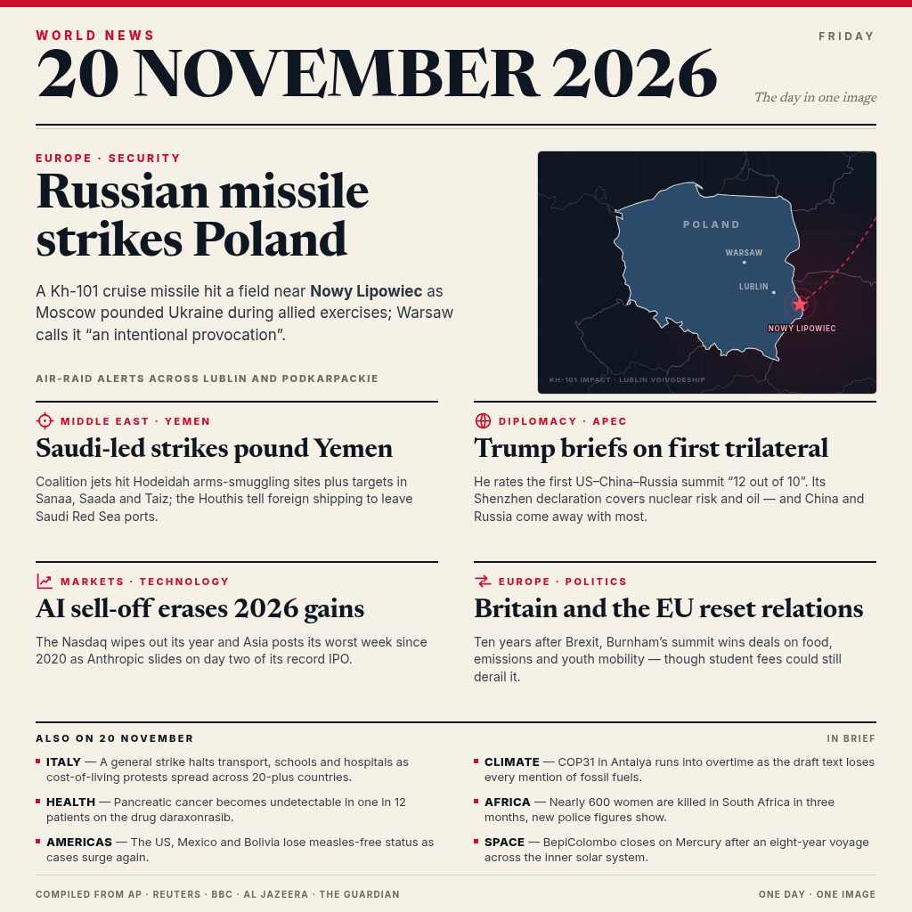

# World news, 20 November 2026 — in one image

An entry for the make.fun bounty [`news-image-20261120`](https://make.fun/c/news-image-20261120):
one image that sums up the world's news of **Friday 20 November 2026**.



## What the image shows

A front page dated 20 November 2026, led by the day's biggest story and covering the day across
regions and beats:

| Story | Beat |
| --- | --- |
| A Russian Kh-101 cruise missile strikes Poland near Nowy Lipowiec, with air-raid alerts across Lublin and Podkarpackie; Warsaw calls it "an intentional provocation" | Europe · security (lead, with map) |
| Saudi-led coalition strikes on Hodeidah arms sites and targets in Sanaa, Saada and Taiz; the Houthis demand foreign shipping leave Saudi Red Sea ports | Middle East |
| Trump briefs on the first US–China–Russia trilateral in Shenzhen, rating it "12 out of 10" | Diplomacy · Asia-Pacific |
| The AI sell-off erases the Nasdaq's 2026 gains; Asia's worst week since 2020 as Anthropic slides after its record IPO | Markets · technology |
| Britain and the EU reset relations ten years after Brexit: food, emissions and youth mobility deals | Europe · politics |
| Also: Italy's general strike and Europe-wide cost-of-living protests · COP31 overtime in Antalya · the daraxonrasib pancreatic-cancer trial · nearly 600 women killed in South Africa in three months · the US, Mexico and Bolivia losing measles-free status · BepiColombo closing on Mercury | Labour · climate · health · Africa · Americas · science |

Facts are taken from the day's reporting by AP, Reuters, BBC, Al Jazeera and The Guardian, and from
Wikipedia's current-events record for 20 November 2026. The map is drawn from Natural Earth 1:50m
country boundaries (public domain); the missile marker, arc and labels are drawn for this image.

## How the entry runs

`main.ts` is a Node 22 program using the standard library only. It writes `entry.png` to `/output`
(the harness mounts the repository read-only at `/bot`, with a writable `/output`, no network). It
copies the committed artwork byte for byte, so the grader's two runs produce identical output.

```sh
mkdir -p out && MAKEFUN_OUTPUT_DIR=out node main.ts   # writes out/entry.png
```

Artifact: PNG, 1024 × 1024, ~210 KB — inside the 1024 × 1024 pixel and 1 MiB limits.

## Regenerating the artwork

The page is drawn as HTML/CSS/SVG and rendered once with headless Chromium:

```sh
node art/build.mjs        # renders art/news.html -> entry.png (1024 x 1024)
```

- `art/news.html` — the whole layout: type, grid, the Poland map and the card icons.
- `art/map.js` — the projected country outlines the map draws (Natural Earth 1:50m, public domain).
- `art/fonts/` — Inter and Newsreader, bundled under the SIL Open Font License 1.1
  (<https://scripts.sil.org/OFL>).

Only `main.ts` and `entry.png` are needed to run the entry; `art/` is the source of the picture.

## Layout notes

Designed to read at about 300 pixels across: the date, the lead headline and the four card
headlines carry the page at thumbnail size, while the decks, briefs and map labels carry the detail
at full size. One accent colour (news red) on warm paper, a two-column grid, and a single hero map
keep the composition calm and the text clean.

## License

MIT — see [LICENSE](LICENSE). The bundled fonts are licensed separately under the SIL Open Font
License 1.1 (<https://scripts.sil.org/OFL>); the map outlines are Natural Earth data, public domain.
